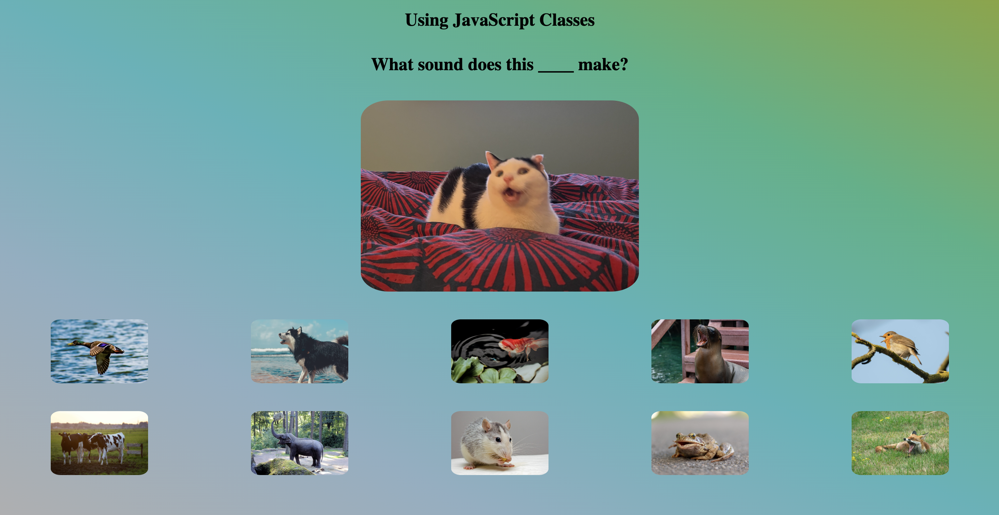

<h1>
  <span class="headline">Playing Audio in the Browser</span>
  <span class="subhead">Setup</span>
</h1>

## Setup

Open your Terminal application and navigate to your `~/code/ga/lectures` directory:

```bash
cd ~/code/ga/lectures
```

Fork the [playing-audio-in-the-browser-starter-code](https://github.com/ga-curriculum/playing-audio-in-the-browser-starter-code-v2) repository.

Clone a copy of your remote repo locally by using the `git clone` command:

```bash
git clone https://github.com/<your-username>/playing-audio-in-the-browser-starter-code-v2.git
```

> 📚 Note: In the link above, where it says `<your-username>`, you should see the username from your GitHub account.

Next, `cd` into your new cloned directory, `playing-audio-in-the-browser-starter-code-v2`:

```bash
cd playing-audio-in-the-browser-starter-code-v2
```

Open the project's folder in your code editor:

```bash
code .
```

Open your `index.html` file in the browser. You should see something like this:

